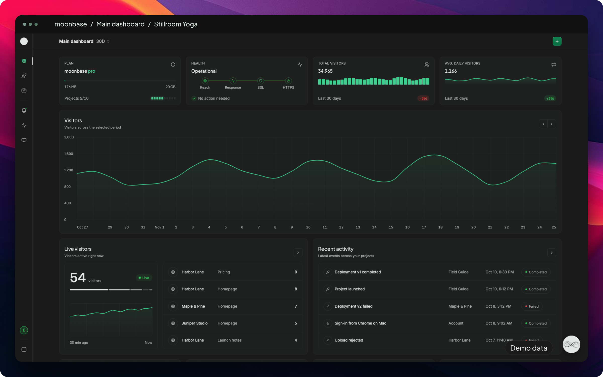
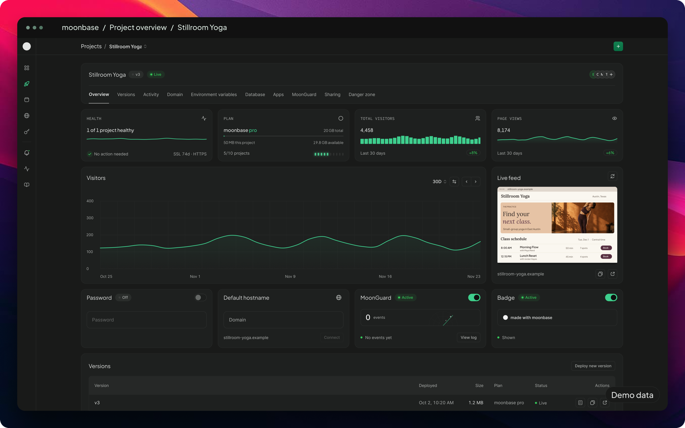

<p align="center">
  <a href="https://moonbase.cloud/?utm_source=github&utm_medium=org-readme&utm_campaign=gh-launch">
    <picture>
      <source media="(prefers-color-scheme: dark)" srcset="https://raw.githubusercontent.com/Moonbasecloud/.github/main/profile/assets/banner-dark.png">
      
    </picture>
  </a>
</p>

<p align="center">
  <a href="https://moonbase.cloud/?utm_source=github&utm_medium=org-readme&utm_campaign=gh-launch"><b>Website</b></a>
  &nbsp;·&nbsp;
  <a href="https://moonbase.cloud/docs/deploy-from-ai-chat?utm_source=github&utm_medium=org-readme&utm_campaign=gh-launch"><b>Connect your AI</b></a>
  &nbsp;·&nbsp;
  <a href="https://gh-example-event-rsvp.moonbase.host"><b>Open live demo</b></a>
  &nbsp;·&nbsp;
  <a href="https://moonbase.cloud/docs/getting-started?utm_source=github&utm_medium=org-readme&utm_campaign=gh-launch"><b>Docs</b></a>
  &nbsp;·&nbsp;
  <a href="https://moonbase.cloud/pricing?utm_source=github&utm_medium=org-readme&utm_campaign=gh-launch"><b>Pricing</b></a> <sub>(Free plan included)</sub>
</p>

<br/>

You build your app in Claude, ChatGPT, Cursor or another AI agent, and moonbase puts it live with a managed PostgreSQL database, a free HTTPS address, versions you can roll back to and visitor analytics, all run from the same chat with no servers to manage.

## Quick start

1. **Add the connector** to your AI tool. You sign in to moonbase in the browser and approve access; no API key goes into the chat.

   ```text
   https://app.moonbase.cloud/mcp
   ```

   Setup steps for Claude, ChatGPT, Cursor, VS Code, Gemini CLI and Devin Desktop: [Deploy from any AI chat](https://moonbase.cloud/docs/deploy-from-ai-chat?utm_source=github&utm_medium=org-readme&utm_campaign=gh-launch).
2. **Ask for your app** in the chat, for example: *"Build me an event page for the Riverbend Summer Picnic where guests can RSVP, with a database for guests, and put it live on moonbase."*

   Already have the project? If it is open in an AI coding tool that can read its files (Claude Code, Cursor, Codex and others), ask it to deploy. If you only have the files, upload a ZIP with the **+ New mission** button in the moonbase app.
3. **Keep running it from the chat**: *"Connect my domain."* · *"Roll back to yesterday's version."* · *"How many visitors did I get this week?"*

   Every project gets a free address on moonbase.host. Connecting your own domain is on paid plans.

New here? Start with the [getting started guide](https://moonbase.cloud/docs/getting-started?utm_source=github&utm_medium=org-readme&utm_campaign=gh-launch) or open the ready-made version of the app above, event-rsvp ([live demo](https://gh-example-event-rsvp.moonbase.host) · [code](https://github.com/Moonbasecloud/moonbase-examples/tree/main/event-rsvp)), from the first prompt to a follow-up change.

<p align="center">
  
  <br/><sub>Your moonbase dashboard: every app, its visitors and its storage in one place. (Demo data.)</sub>
</p>

<p align="center">
  
  <br/><sub>One project: health, visitors, domain, versions. (Demo data.)</sub>
</p>

## What moonbase runs for your app

- **🗄️ Database:** A managed PostgreSQL database, up to one per project, on every plan — Free included. Created when your app asks for it, connected for you.
- **🚀 Hosting & deploy:** Your app goes live on a free HTTPS address on moonbase.host. Your agent reports when it is up, or tells you why a deploy failed, from the deploy history.
- **🌐 Custom domains:** Add your own domain, verify it and check it, step by step. <sub>(paid plans)</sub>
- **⏪ Versions & rollback:** See your app's earlier versions and restore a saved code version in one step. Your app's data in its database is kept.
- **📈 Analytics:** Visitors over 7 and 30 days, your top pages and where visitors came from.
- **🔒 Password protection:** Put a password on a project while you work on it.
- **🔐 Environment variables:** List, set and remove them. Secret values are typed on moonbase's own page, never in chat.
- **👥 Team access:** Invite members and set their roles. <sub>(paid plans)</sub>
- **📦 Export:** The project owner downloads the code of the live version or any of the last 10 versions, as deployed.

## Open source on GitHub

- **[moonbase-skill](https://github.com/Moonbasecloud/moonbase-skill)**: the moonbase Skill: teaches any AI agent to build, launch and run apps on moonbase, database included. Files for Claude, ChatGPT, Cursor, Copilot and Gemini, plus AGENTS.md for Codex and other agents. MIT licensed.
- **[moonbase-examples](https://github.com/Moonbasecloud/moonbase-examples)**: small apps that deploy to moonbase as they are, each with a one-line prompt for your AI agent, including the event page with RSVPs from the quick start, an Express guestbook and a Next.js app, each with a managed PostgreSQL database. Use one as a template. MIT licensed.
- **[moonbase-deploy-action](https://github.com/Moonbasecloud/moonbase-deploy-action)**: a GitHub Action that deploys your repository to moonbase on every push, with your API key kept as a repository secret. The job passes only when the deploy is live. Use `Moonbasecloud/moonbase-deploy-action@v1`. MIT licensed.

## Connect

- **Connector (MCP) address:** the one in the [quick start](#quick-start), to copy from there.
- **Setup for Claude, ChatGPT, Cursor, VS Code, Gemini CLI and Devin Desktop:** [Deploy from any AI chat](https://moonbase.cloud/docs/deploy-from-ai-chat?utm_source=github&utm_medium=org-readme&utm_campaign=gh-launch)
- **Agent instructions (Skill):** [moonbase-skill](https://github.com/Moonbasecloud/moonbase-skill), versioned and updated with the product
- **CI / GitHub Actions:** [Deploying from GitHub Actions](https://moonbase.cloud/docs/github-actions-ci-cd?utm_source=github&utm_medium=org-readme&utm_campaign=gh-launch)

## Badge

Running on moonbase? Show it in your README:

<a href="https://moonbase.cloud/?utm_source=github&utm_medium=badge&utm_campaign=made-with">
  <picture>
    <source media="(prefers-color-scheme: dark)" srcset="https://raw.githubusercontent.com/Moonbasecloud/.github/main/profile/assets/badge-made-with-moonbase-dark.svg">
    
  </picture>
</a>

```md
[](https://moonbase.cloud/?utm_source=github&utm_medium=badge&utm_campaign=made-with)
```

## Security and trust

- **Report a vulnerability privately:** use **Report a vulnerability** in the Security tab of any of our public repositories, or email [admin@moonbase.cloud](mailto:admin@moonbase.cloud), the contact on [moonbase.cloud/security](https://moonbase.cloud/security?utm_source=github&utm_medium=org-readme&utm_campaign=gh-launch) and in [security.txt](https://moonbase.cloud/.well-known/security.txt). Please don't open a public issue. Details: [SECURITY.md](https://github.com/Moonbasecloud/.github/blob/main/SECURITY.md).
- **Verified organization:** this GitHub organization's domain is verified by GitHub.
- **Is moonbase up?** [moonbase.cloud/status](https://moonbase.cloud/status?utm_source=github&utm_medium=org-readme&utm_campaign=gh-launch)

## Support and community

- **Help with your account or a project:** the [contact page](https://moonbase.cloud/contact?utm_source=github&utm_medium=org-readme&utm_campaign=gh-launch), or email [contact@moonbase.cloud](mailto:contact@moonbase.cloud).
- **A wrong fact in the Skill or a broken example:** open an issue in [moonbase-skill](https://github.com/Moonbasecloud/moonbase-skill/issues) or [moonbase-examples](https://github.com/Moonbasecloud/moonbase-examples/issues).
- **Questions and ideas:** [Discussions in moonbase-skill](https://github.com/Moonbasecloud/moonbase-skill/discussions).
- **Follow along:** [X](https://x.com/moonbase_cloud) · [LinkedIn](https://www.linkedin.com/company/moonbase-cloud) · [Changelog](https://moonbase.cloud/changelog?utm_source=github&utm_medium=org-readme&utm_campaign=gh-launch)

---

<p align="center">
  <a href="https://moonbase.cloud/changelog?utm_source=github&utm_medium=org-readme&utm_campaign=gh-launch">Changelog</a> ·
  <a href="https://moonbase.cloud/status?utm_source=github&utm_medium=org-readme&utm_campaign=gh-launch">Status</a> ·
  <a href="https://moonbase.cloud/security?utm_source=github&utm_medium=org-readme&utm_campaign=gh-launch">Security</a> ·
  <a href="https://github.com/Moonbasecloud/.github/blob/main/SUPPORT.md">Support</a> ·
  <a href="https://moonbase.cloud/contact?utm_source=github&utm_medium=org-readme&utm_campaign=gh-launch">Contact</a> ·
  <a href="https://moonbase.cloud/llms.txt">llms.txt</a> ·
  <a href="https://x.com/moonbase_cloud">X</a> ·
  <a href="https://www.facebook.com/moonbasecloud">Facebook</a> ·
  <a href="https://www.tiktok.com/@moonbase.cloud">TikTok</a> ·
  <a href="https://www.instagram.com/moonbase.cloud/">Instagram</a> ·
  <a href="https://www.linkedin.com/company/moonbase-cloud">LinkedIn</a>
</p>

<p align="center"><sub>Built by <a href="https://moonbase.cloud/about?utm_source=github&utm_medium=org-readme&utm_campaign=gh-launch">Moxie A.R. LTD</a></sub></p>
