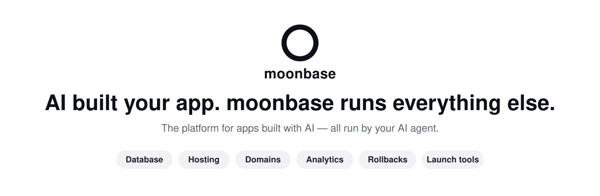

  <a href="https://moonbase.cloud/?utm_source=github&utm_medium=org-readme&utm_campaign=gh-launch">
    <picture>
      <source media="(prefers-color-scheme: dark)" srcset="https://raw.githubusercontent.com/Moonbasecloud/.github/main/profile/assets/banner-dark.svg">
      
    </picture>
  </a>

  <a href="https://moonbase.cloud/?utm_source=github&utm_medium=org-readme&utm_campaign=gh-launch"><b>Website</b></a>
  &nbsp;·&nbsp;
  <a href="https://moonbase.cloud/docs/deploy-from-ai-chat?utm_source=github&utm_medium=org-readme&utm_campaign=gh-launch"><b>Connect your AI agent</b></a>
  &nbsp;·&nbsp;
  <a href="https://moonbase.cloud/docs/getting-started?utm_source=github&utm_medium=org-readme&utm_campaign=gh-launch"><b>Docs</b></a>
  &nbsp;·&nbsp;
  <a href="https://moonbase.cloud/pricing?utm_source=github&utm_medium=org-readme&utm_campaign=gh-launch"><b>Pricing</b></a> (Free plan included)

 

## ✨ How it works

<table>
  <tr>
    <td width="33%" valign="top">
      <h3>1 · Connect once</h3>
      Add the moonbase connector (MCP) to Claude, ChatGPT, Cursor or another assistant that supports connectors. You sign in to moonbase in the browser and approve access.  
      No API key goes into the chat.
    </td>
    <td width="33%" valign="top">
      <h3>2 · Ask for your app</h3>
      <i>“Build me a booking app for my yoga studio, with a database for clients and classes, and put it live on moonbase.”</i>  
      Your agent writes the app, moonbase creates its PostgreSQL database, and you get a live HTTPS link.
    </td>
    <td width="33%" valign="top">
      <h3>3 · Run it from the chat</h3>
      <i>“Add a page for monthly passes.”</i> 
      <i>“Connect my domain.”</i> 
      <i>“Roll back to yesterday's version.”</i> 
      <i>“How many visitors did I get this week?”</i>
    </td>
  </tr>
</table>

## 🧩 What the moonbase platform runs for your app

<table>
  <tr>
    <td width="33%" valign="top">
      <h4>🗄️ Database</h4>
      A managed PostgreSQL database, up to one per mission, on every plan — Free included. Created on deploy, connected for you. Import from another provider, or export yours.
    </td>
    <td width="33%" valign="top">
      <h4>🚀 Hosting & deploy</h4>
      Your app goes live on an HTTPS address. Your agent reports when it is up — or explains why not, from the deploy logs.
    </td>
    <td width="33%" valign="top">
      <h4>🌐 Custom domains</h4>
      Add your own domain, verify it and check it, step by step.
    </td>
  </tr>
  <tr>
    <td width="33%" valign="top">
      <h4>⏪ Versions & rollback</h4>
      See your app's earlier versions and put one back in one step.
    </td>
    <td width="33%" valign="top">
      <h4>📈 Analytics</h4>
      Visitor stats, plus which search engines and AI crawlers read your app.
    </td>
    <td width="33%" valign="top">
      <h4>🧰 Launch tools</h4>
      Launch check for Google, AI tools and chat apps · forms inbox · downtime alerts by email · Google Search Console setup.
    </td>
  </tr>
  <tr>
    <td width="33%" valign="top">
      <h4>🔐 Environment variables</h4>
      List, set and remove them. Secret values are typed on moonbase's own page, never in chat.
    </td>
    <td width="33%" valign="top">
      <h4>👥 Team access</h4>
      Invite members and set their roles. (paid plans)
    </td>
    <td width="33%" valign="top">
      <h4>📦 Export</h4>
      Download your app's source any time. It's yours.
    </td>
  </tr>
</table>

## 📂 Open source here

| Repository | What it is |
|---|---|
| **[moonbase-skill](https://github.com/Moonbasecloud/moonbase-skill)** | The moonbase Skill: teaches any AI agent to build, launch and run apps on the moonbase platform, database included. Files for Claude, ChatGPT, Cursor, Copilot, Gemini and AGENTS.md. |
| **[moonbase-examples](https://github.com/Moonbasecloud/moonbase-examples)** | Three small apps that run on moonbase as they are: a static page, an Express app with a database, and a minimal Next.js app. Use it as a template. |

## 🔌 Connect

| | |
|---|---|
| **Connector (MCP) address** | `https://app.moonbase.cloud/mcp` |
| **Setup for Claude, ChatGPT, Cursor and others** | [moonbase.cloud/docs/deploy-from-ai-chat](https://moonbase.cloud/docs/deploy-from-ai-chat?utm_source=github&utm_medium=org-readme&utm_campaign=gh-launch) |
| **Agent instructions (Skill)** | [moonbase-skill](https://github.com/Moonbasecloud/moonbase-skill) — versioned and updated with the product |
| **CI / GitHub Actions** | [Deploying from GitHub Actions](https://moonbase.cloud/docs/github-actions-ci-cd?utm_source=github&utm_medium=org-readme&utm_campaign=gh-launch) |

---

  <a href="https://moonbase.cloud/changelog?utm_source=github&utm_medium=org-readme&utm_campaign=gh-launch">Changelog</a> ·
  <a href="https://moonbase.cloud/status?utm_source=github&utm_medium=org-readme&utm_campaign=gh-launch">Status</a> ·
  <a href="https://moonbase.cloud/security?utm_source=github&utm_medium=org-readme&utm_campaign=gh-launch">Security</a> ·
  <a href="https://github.com/Moonbasecloud/.github/blob/main/SUPPORT.md">Support</a> ·
  <a href="https://moonbase.cloud/contact?utm_source=github&utm_medium=org-readme&utm_campaign=gh-launch">Contact</a> ·
  <a href="https://moonbase.cloud/llms.txt">llms.txt</a>

